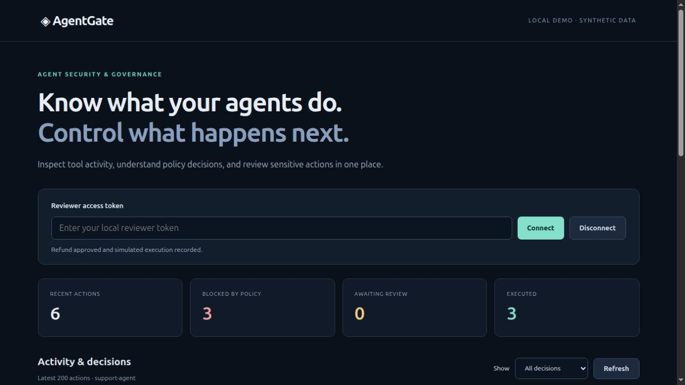

# AgentGate

[](https://github.com/Josdip/agentgate/actions/workflows/ci.yml)

**Observe AI agent tool calls. Enforce policy. Review sensitive actions.**

AgentGate is a local security gateway for a synthetic customer-support agent. It controls tool execution, records policy decisions, and gives a human reviewer a dashboard for approving sensitive requests.

**Status:** working portfolio prototype. Business data and tool effects are synthetic. The demo is scripted; no LLM or paid provider account is required.

## What you can demonstrate

- A scoped document read and $25 refund execute successfully.
- A $250 refund waits for human approval.
- An unauthorized document, unapproved destination, and unknown tool are denied.
- A reviewer sees the rule, explanation, request metadata, and outcome.
- Agent credentials cannot approve actions; concurrent or repeated reviews cannot execute a refund twice.

## Run locally

Requires Python 3.12+.

```bash
python3 -m venv .venv
.venv/bin/pip install -r requirements-dev.lock
.venv/bin/pip install --no-deps --no-build-isolation -e .
.venv/bin/python -m agentgate
```

In another terminal:

```bash
.venv/bin/python examples/demo.py
```

Open [the local dashboard](http://127.0.0.1:8000). The launcher generates `.env`; use its `AGENTGATE_REVIEWER_TOKEN` to connect. Inspect activity, then approve or reject the pending refund. Credentials and SQLite data are ignored by Git.



## Architecture

```text
Scripted agent ──agent token──> FastAPI gateway ──> Policy engine
                                     │                  │
                                     ├──> SQLite audit  └──> Synthetic tools
                                     │
Reviewer dashboard ──reviewer token──┘
```

Python/FastAPI · SQLite · browser-native JavaScript · Pytest · Ruff · GitHub Actions

The gateway assigns identity from credentials and validates strict tool schemas before execution. Approved refunds use stored requests inside a serialized transaction. This atomicity applies to the simulated tools; real external integrations require idempotency and failure recovery.

## Verification

```bash
make check
```

Tests cover authorization boundaries, malformed arguments, refund thresholds, default-deny behavior, persistence, privacy redaction, and approval replay/concurrency. The six-scenario demo checks its HTTP outcomes automatically.

## Documentation

| Guide | Contents |
|---|---|
| [Development](docs/development.md) | Setup, demo, configuration, checks, Git workflow, troubleshooting |
| [Architecture](docs/architecture.md) | Components, request lifecycle, policy table, API, state, privacy |
| [Threat model](docs/threat-model.md) | Assets, attack cases, controls, limitations |
| [Roadmap](docs/roadmap.md) | Real agent integration, production hardening, portfolio release |
| [Decision record](docs/decisions/001-local-first.md) | Why local-first deterministic enforcement |
| [Build log](docs/build-log.md) | Implementation context and development decisions |
| [Contributing](CONTRIBUTING.md) | Focused commits, testing, documentation expectations |

## Boundaries

This prototype checks tool actions, not agent intent. Blocking an unapproved destination is not proof of prompt-injection detection. It has no tenant isolation, production identity provider, real business integrations, tamper-proof audit storage, or cumulative refund budget. See the threat model before extending it.
