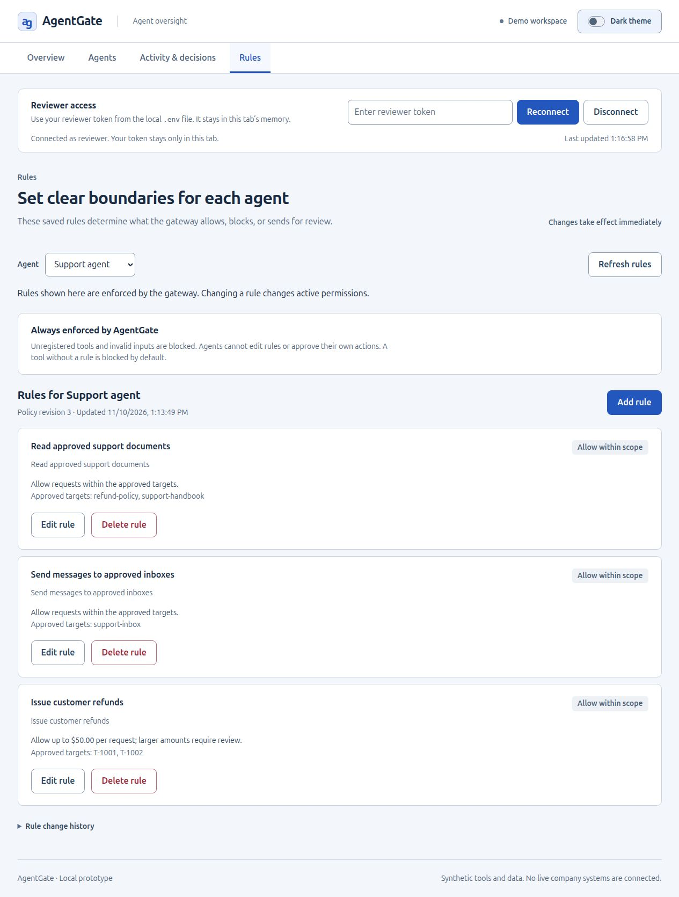

# View and manage the rules behind agent decisions

## Use the Rules page

Open **Rules** in the navigation and choose Support, Sales, or Finance. The page shows the actual saved rules enforced by the gateway, their policy revision, and change history. Agent profiles and detailed activity records link to this page. Activity evidence records the revision and matched rule ID; the link opens current rules, which may differ from an older decision.

- **Add rule:** choose a registered tool, give the rule a name, and specify its behavior and exact targets.
- **Edit rule:** change targets, decision, or the monetary approval limit. Saving takes effect immediately for subsequent requests.
- **Delete rule:** review the confirmation and choose Delete rule. No rule means the tool is blocked, rather than implicitly allowed. Deleted definitions remain in history.

One rule per tool per agent avoids ambiguous ordering or conflicting grants. A missing tool rule blocks the tool. Targets are exact, case-sensitive values, one per line, not patterns. Wildcards and executable conditions are unsupported. For a block rule, the entire tool is blocked regardless of target.

## Decisions and limits

| Decision | Meaning |
|---|---|
| Allow within approved targets | Permit requests to listed targets; refund/payment amounts above the configured limit still need review |
| Require review for every request | Listed targets are eligible for human review; other targets are denied |
| Block this tool entirely | Deny every request to that tool for this agent |

For refunds/payments, allow rules require an automatic approval limit in USD per request. The editor converts up to two decimal places to integer cents without float rounding. Zero requires review for every positive amount. The current schema caps both request amounts and approval limits at $10,000; these are per-request limits, not cumulative budgets.

Rules can grant a registered tool that an agent did not initially have. For example, adding a refund rule for Sales can permit its formerly denied refund case. Changes are deliberately permission changes, not descriptive inventory edits. All tools still simulate effects; registering a target does not connect a real account or service.

## Always-enforced boundaries

The Rules page does not let users disable server-owned identity, strict argument validation, registered-tool checks, or separation between agent and reviewer credentials. Unknown tools are always blocked. Rules cannot execute code or commands. The synthetic document/ticket executors support a finite set of IDs; invalid grants are rejected rather than reaching an executor with missing data.

Only the reviewer credential can read/manage rules. Agent credentials cannot edit their own access or approve requests. This prototype uses one privileged reviewer role (`local-reviewer`), not individual user attribution or production administrator/reviewer separation.

## Pending requests after a change

Each agent has an independent monotonically increasing policy revision. Every successful add/edit/delete increments it and records a complete snapshot, operation, time, and actor. Stale editor submissions return HTTP 409; polling does not overwrite an unsaved draft.

Requests record the policy revision and matched rule ID at evaluation. Submission, rule lookup, audit insertion, and simulated execution use one serialized SQLite transaction. Rule writes use the same write-lock boundary.

Approval rechecks the current policy while holding a write transaction. If *any rule for that agent* changed since submission, the old request cannot be approved—even if the change appears less restrictive or concerns another tool. Reject it and submit a new request. Rules for a different agent do not invalidate it. Rejection remains available after a change.

The history view shows the latest 20 revisions; all historical snapshots remain stored. It is not a tamper-proof audit ledger or a complete historical policy browsing/export interface.

## Existing data and setup

On first startup, AgentGate adds `agent_policies`, `policy_rules`, and `policy_history`, seeds each agent with its original defaults, and adds nullable `policy_revision`/`matched_rule_id` action columns. Existing actions and profile metadata remain. An existing policy is never reseeded on restart, including when all its rules have been deleted.

Use a separate database or backup for comparisons with older branches: pre-Rules application code does not read these stored policies and must not be used to enforce custom rule settings. This migration is not an automatic downgrade mechanism.

Older actions retain unknown policy provenance. A legacy pending request without a policy revision cannot be approved after this upgrade; reject it and submit it again. Tokens and dependencies are unchanged.

Stop your old server, switch to the task branch, and restart to load the new API:

```bash
cd /home/josdip10/Documents/ChatGPT/Agents/agentgate
git switch codex/agent-rules
.venv/bin/python -m agentgate
```

Then open `/rules` and connect with your existing reviewer token. The branch is based on main, which now includes the separately approved readable-interface and theme-toggle merges. The Rules changes themselves are not merged or deployed by this task.

## API

All endpoints below require the reviewer token.

| Method | Path | Body/query |
|---|---|---|
| GET | `/api/agents/{agent_id}/rules` | Active rules, revision, catalog, latest history |
| POST | `/api/agents/{agent_id}/rules` | `{ "revision": 1, "rule": { ... } }` |
| PUT | `/api/agents/{agent_id}/rules/{rule_id}` | Same payload with current revision |
| DELETE | `/api/agents/{agent_id}/rules/{rule_id}?revision=2` | Required current revision; no body |

Rule fields: `name`, registered `tool`, `decision` (`allow`, `deny`, `review`), `scope` array, and `approval_threshold_cents`. The threshold is required for allow-mode refunds/payments and must be null for other cases. Unknown fields, malformed scopes, duplicate tools, stale revisions, and unsupported tool grants are rejected. Existing default-rule classification strings remain in the action `rule` field; `matched_rule_id` identifies the concrete stored rule.

`Store.submit` is the gateway enforcement entry point and always loads active stored rules. Pure `evaluate`/`tool_permissions` helpers retain default fixtures for compatibility with examples/tests; calling them without stored rules is not a live policy lookup. Registry tool entries are now seed configuration, not an override of saved permissions.

## Demo and verification

The fourteen scenario fixtures retain their original expected outcomes. The UI labels them as default expectations; a custom rule may correctly produce a different result. The current rule and policy revision explain that difference.

- 80 Python tests cover original behavior, reviewer-only management, real decision changes, per-agent scope, persistence, fail-closed deletion/restart, validation bypasses, stale/legacy approvals, redaction, concurrent edits, and atomic submission/rule changes.
- 11 JavaScript tests cover existing interface behavior plus exact currency parsing and deletion re-enabling Add/default-deny empty state.
- Browser checks added/edited/deleted a rule, canceled deletion, saw history, changed a $25 refund from execution to review by setting a $20 limit, preserved a draft across a competing edit, rejected stale saves, and prevented approval after a later policy change.
- Light/dark screens and 390px mobile navigation were checked. Navigation targets were 44px tall with no horizontal overflow. Existing native-zoom/full accessibility audit limits remain. The temporary port-8011 QA server was stopped.

Real side effects still require protected pending payloads, idempotency, and durable failure recovery. Message bodies remain redacted; review-mode message tools are safe here because delivery is simulated. Versioned rule history and static tokens are not production identity, tenant isolation, or tamper-proof evidence.



[Editor](images/rules/editor.png) · [Dark theme](images/rules/dark.png) · [Mobile](images/rules/mobile.png)
