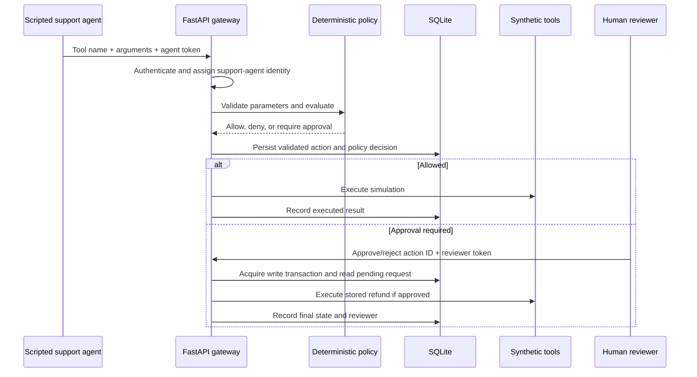

# Architecture

> Current launcher: local demo access is automatic; no reviewer token entry is needed. See [local demo access](local-demo-access.md). Bearer-token instructions below apply to optional authenticated mode.

For the current editable policy layer, see [agent rules](agent-rules.md). Tables and thresholds below describe initial defaults; active permissions now come from stored, versioned per-agent rules.

## Implemented flow

`policy.py` contains pure rules and synthetic tools. `store.py` owns persistence and serializes review transitions with `BEGIN IMMEDIATE`. `app.py` authenticates each endpoint, assigns server-owned identities, and serves the static dashboard. The CLI creates development credentials and binds only to loopback. The demo uses Python's standard HTTP client.

## Identity and trust boundaries

One configured agent token maps to `support-agent`; the separate reviewer token maps to `local-reviewer`. A tool request cannot supply an identity, approval flag, result, or outcome. Agent credentials cannot list audit history or review actions; reviewer credentials cannot submit agent tool calls. No endpoint bypasses policy to invoke arbitrary tools.

The agent must not possess real tool credentials in future integrations. Credentials and network restrictions must make the gateway the actual execution path; otherwise an agent could bypass enforcement.

## Policy v1

| Tool | Valid request | Outcome |
|---|---|---|
| `documents.read` | `refund-policy` or `support-handbook` | Execute |
| `documents.read` | Any other document ID | Deny |
| `refunds.create` | Known ticket; integer amount 1–10,000 cents | Execute |
| `refunds.create` | Known ticket; integer amount 10,001–1,000,000 cents | Pending |
| `messages.send` | Exact destination `support-inbox` | Simulate delivery |
| `messages.send` | Any other destination | Deny |
| Any unregistered tool | Any arguments | Deny |

Invalid schemas return HTTP 422 before persistence or execution. Refund values are integers in USD cents; bools, floats, strings, zero, and negative values are rejected. Ticket IDs are synthetic constants. Unknown keys are forbidden in registered schemas.

## State and durability

Validated actions are created as denied, pending, or allowed. Allowed actions become executed in the same transaction. Pending actions may transition to executed or rejected exactly once. Reviews use the stored request; reviewers cannot change refund amounts. Approved refunds retain the original `refunds.approval` rule as the explanation for escalation.

The single-row audit representation stores initial policy metadata and final reviewer/time, rather than an append-only event ledger. It is not tamper-proof. At most 200 recent records are returned by the API; all rows remain in SQLite. Invalid authentication/validation attempts are not stored in this business audit table.

Execution and audit writes are atomic only because tools are local simulations. Real external actions require idempotency keys, explicit failure states, retries, and an outbox or equivalent recovery design. Approval expiry and policy re-evaluation are not implemented.

## API

All protected endpoints require `Authorization: Bearer <token>`.

| Method | Path | Role | Behavior |
|---|---|---|---|
| GET | `/health` | Public | Synthetic mode health signal |
| GET | `/` | Public | Dashboard shell, no business data |
| GET | `/openapi.json` | Public | Generated API schema |
| POST | `/api/actions` | Agent | Validate, evaluate, persist, possibly execute; HTTP 201 |
| GET | `/api/actions` | Reviewer | Latest 200 actions, newest first |
| POST | `/api/actions/{id}/review` | Reviewer | `{ "approve": true/false }`; HTTP 200 |

Authentication failures return 401, missing review targets 404, replayed decisions 409, invalid input 422. A denied tool call still returns 201 because its audit record was created; clients must inspect `outcome`.

## Privacy

No raw prompts or model conversations are collected. Message bodies and unknown tool arguments are omitted/redacted before storage. Document IDs, ticket IDs, amounts, destinations, and run IDs are retained. Do not put secrets into these fields. The reviewer token stays in browser memory, and API content renders via `textContent` rather than HTML insertion. Restarting or disconnecting the tab clears its credential.

## Interactive scenarios and ongoing inventory

See [the live demo/profile guide](live-demo-and-profile.md) for the new reviewer-only API endpoints and UI. `scenarios.py` owns the six immutable synthetic fixtures shared by CLI and dashboard. The runner accepts a scenario ID, rejects bodies, and calls the same `Store.submit` enforcement path as the agent endpoint. Reviewer privileges now include triggering these bounded simulations; arbitrary reviewer tool calls remain disallowed.

`agent_profiles` stores metadata with an optimistic revision; `profile_history` records each revision's snapshot, timestamp, and actor. Startup creates both tables and inserts the initial support-agent profile only if absent. Existing actions remain intact. Model connections are declared inventory with an unverified label, not live integrations. Profile tools and scopes are derived from policy code; metadata updates cannot alter permissions. Profile activity is aggregated over all stored actions, independently of the list endpoint's 200-row limit.

## Multi-agent navigation and query API

The latest contract is in [navigation and multi-agent demos](navigation-and-agents.md). `registry.py` owns Support/Sales/Finance identities and scopes. Agent credentials map to one server-selected identity before `Store.submit` evaluates its permissions. Reviewer demo endpoints use the server catalog's identity. Tools remain synthetic. Existing profile endpoints are compatibility aliases; new endpoints scope profile edits and history per agent.

`/api/overview` aggregates all actions and returns three recent rows. `/api/activity` applies SQL filters and bounded descending row-ID cursor pagination; the browser never loads the complete audit trail. Indexes are created on agent, outcome, and risk. Search and total counts are not yet optimized for large production datasets. Separate URL-backed client views retain credentials only in memory across navigation.
