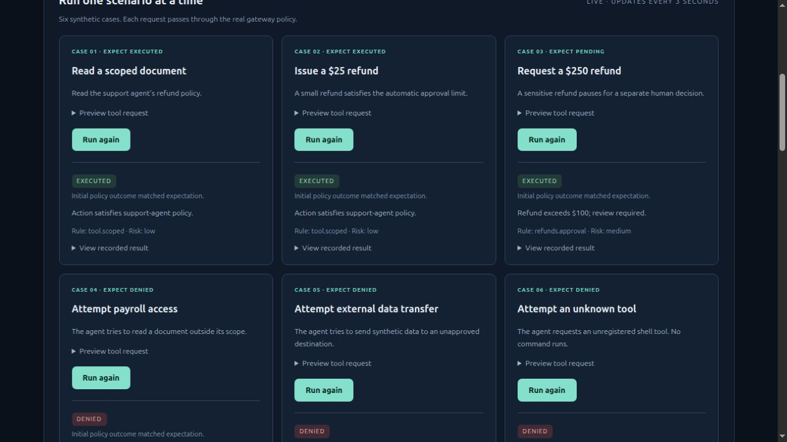
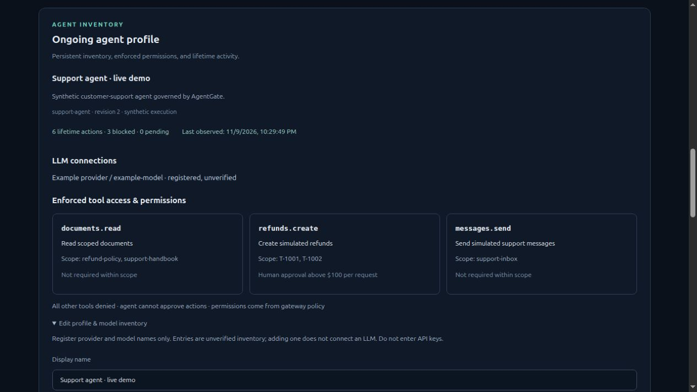

# Live dashboard demo and agent profile

> Current launcher: local demo access is automatic; no reviewer token entry is needed. See [local demo access](local-demo-access.md). Bearer-token instructions below apply to optional authenticated mode.

Active permissions can now be edited on the dedicated [Rules page](agent-rules.md); earlier statements about code-only permissions describe the original prototype.

For the latest three-agent navigation and fourteen-case behavior, see [navigation and multi-agent demos](navigation-and-agents.md). The sections below describe the original Support cases and the shared profile editor. Inventory is now on its own page; approvals are on Activity & decisions.

## Update an existing clone

Stop the old server with Ctrl+C, then run from your clone:

```bash
git pull --ff-only origin main
.venv/bin/python -m agentgate
```

No new dependencies are required. Startup adds profile and profile-history tables to the existing SQLite database without removing audit records. Keep your existing `.env`; the reviewer token stays the same.

## Run the six cases individually

Open `http://127.0.0.1:8000`, enter your reviewer token, and connect. Each scenario card offers a request preview, expected initial outcome, and **Run scenario** button:

1. Read a scoped document → executed.
2. Issue a $25 refund → executed.
3. Request a $250 refund → pending human approval.
4. Attempt payroll access → denied.
5. Attempt external data transfer → denied.
6. Attempt an unknown tool → denied; no shell command runs.

A click submits one fixed server-owned request to the same policy/store path used by agent calls. The card shows the recorded outcome, policy rule, risk, explanation, and inspectable audit result. **Run again** creates a new action; it never reuses a previous approval. Original request previews contain synthetic fixtures; persisted message bodies remain redacted.

For the $250 refund, scroll to **Activity & decisions** and approve or reject it separately. The scenario result and counts update after review. The expected outcome refers to the initial policy decision, so a later approved execution still counts as an initially correct pending result.

Activity and profile data refresh every three seconds while the tab is visible and connected. This is polling, not event streaming. Stable data does not replace open request details. Results on individual scenario cards are held for the current browser session; their audit records persist across reloads and restarts. The CLI `examples/demo.py` remains available and shares the same six fixtures.



## Maintain the agent profile

The profile shows the server-owned agent ID, display name, description, current revision, lifetime action totals, last observed activity, registered LLM inventory, and enforced tool scopes/approval requirements.

Expand **Edit profile & model inventory** to change the display name/description, add or remove provider/model pairs, and save. These values persist in SQLite. Each save creates a revision with the time, reviewer identity, and metadata snapshot. The UI displays the latest 20 revisions; older revisions remain stored. Concurrent editors must reload after a revision conflict rather than overwriting each other's changes.

Model entries are explicitly **registered, unverified**. They do not establish a live provider connection, store credentials, discover models automatically, or attribute actions to a model. No LLM is connected by default because the demo agent is scripted. Enter names and IDs only, never API keys. Removing an entry creates a new revision; previous snapshots still include that entry.

Tool permissions are read-only descriptions derived from the actual gateway policy, including exact document/destination scopes, refund approval limits, unknown-tool denial, and the agent's inability to approve actions. Editing profile metadata cannot grant access. Policy changes are made in code and tracked in Git; the profile history records inventory edits, not historical policy snapshots.

Lifetime statistics cover all actions for `support-agent`, including CLI and dashboard scenarios, even when the activity list's latest-200-record window is exceeded.



## New API endpoints

All require the reviewer credential; the agent credential is rejected.

| Method | Path | Result |
|---|---|---|
| GET | `/api/demo/scenarios` | Six server-owned synthetic fixtures |
| POST | `/api/demo/scenarios/{id}/run` | One audited action plus expected outcome and match flag; no request body allowed |
| GET | `/api/agent` | Persistent inventory, policy-derived permissions, lifetime statistics, recent profile history |
| PUT | `/api/agent` | Update display name, description, and model inventory using the current revision |

Profile updates accept only `revision`, `display_name`, `description`, and `model_connections` (up to ten unique provider/model pairs). Permission, tool, credential, identity, and verification fields cannot be supplied. A stale profile revision returns HTTP 409; invalid input returns 422. The demo runner rejects unknown scenario IDs and caller-supplied bodies, so it cannot become an arbitrary reviewer-controlled tool invocation endpoint.
