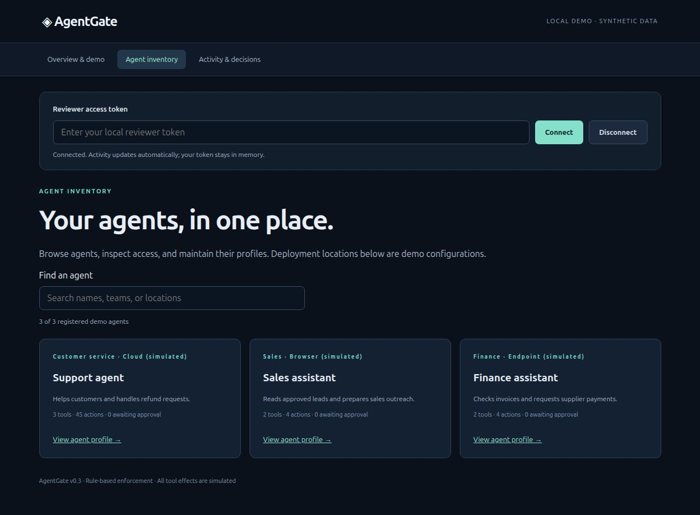
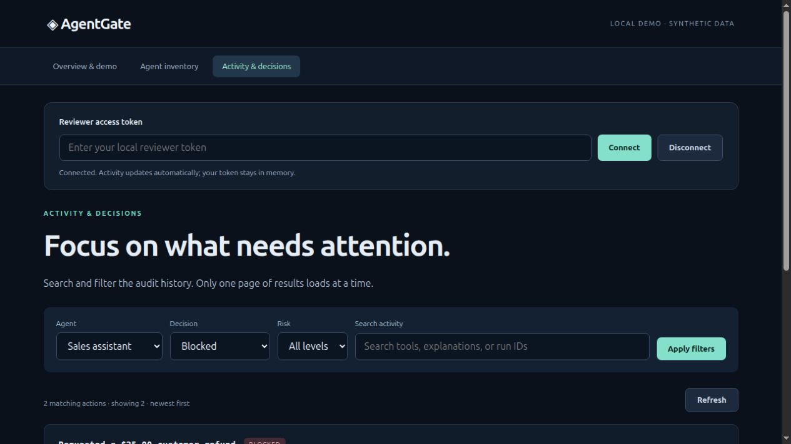

# Product pages and multi-agent demos

> Current launcher: local demo access is automatic; no reviewer token entry is needed. See [local demo access](local-demo-access.md). Bearer-token instructions below apply to optional authenticated mode.

## Update your clone

Stop the server with Ctrl+C, then run:

```bash
cd /home/josdip10/agentgate
git pull --ff-only origin main
.venv/bin/python -m agentgate
```

Reload the browser and connect with your existing reviewer token. No new packages or credentials are needed for the dashboard demos. Startup preserves old actions, names, model inventories, and history while adding the missing Sales/Finance profiles and query indexes.

## Navigation

- **Overview & demo (`/`):** lifetime totals across all agents, a pending-approval shortcut, an agent selector for interactive cases, the real-agent scaffold, and only the latest three actions. The full inventory and audit feed are absent from this page.
- **Agent inventory (`/agents`):** search the three agents by name, team, or simulated deployment location. View profiles at `/agents/{agent_id}`. Each agent has its own editable metadata, model inventory, revision history, activity totals, and enforced tool access.
- **Activity & decisions (`/activity`):** filter by agent, decision, action risk, or text search. Inspect evidence and approve/reject sensitive actions here. Search matches tool names, policy explanations, and run IDs. Agents remain selectable by display name.

Navigation preserves the in-memory reviewer token. Reloading the browser clears it, so reconnect after a reload. Direct page URLs are supported. Locations are simulated demo configuration, not discovered or monitored installations. Model entries remain unverified inventory.

## Bounded activity browsing

The browser requests 20 actions at a time from `/api/activity`. Filtering and pagination happen in SQLite, rather than downloading all actions and hiding them in JavaScript. `Older` and `Newer` use a row-ID cursor; incoming actions do not shift the cursor boundary or duplicate already-browsed records. Only the newest page auto-refreshes every three seconds; older pages stay stable until refreshed manually.

Overview totals and profile totals cover all stored actions, independently of the page window. The overview fetches only three recent records. The activity response includes matching total, items, and an optional next cursor. Page counts reflect the current filter, and applying filters returns to the newest page. Counts and live result sets can change as actions arrive or reviews complete; this is not a point-in-time snapshot/export.

The API caps a page at 100; the UI uses 20. Indexes support agent/decision/risk filters. Text search and matching totals still scan matching data; for production-scale workloads add query benchmarking, time windows, appropriate composite indexes/full-text search, and retention/export rather than claiming unlimited scale.

## Three agents and fourteen cases

| Agent | Team/location (simulated) | Effective access | Cases |
|---|---|---|---|
| Support agent | Customer service / cloud | Scoped documents, ticket refunds, support inbox | Original six: document read, small refund, large refund approval, denied payroll, denied external destination, denied unknown tool |
| Sales assistant | Sales / browser | Two approved leads, sales inbox | Read lead; approved sales message; blocked external transfer; blocked customer refund |
| Finance assistant | Finance / endpoint | Two approved invoices, one approved supplier | Read invoice; $200 payment; $2,500 payment requiring approval; blocked unknown supplier |

Refunds above $100 and supplier payments above $500 need human review. Limits are per request, not cumulative budgets. All tool effects remain synthetic; no real emails, refunds, payments, or network transfers happen. Unknown tools and access outside each agent's scopes are denied. The scenario catalog assigns identity on the server; browsers cannot override it.

Select an agent on the overview, run its cases one by one, and follow **Review this request** for pending actions. The batch CLI remains the original six Support-agent cases, using the existing agent credential.

## Identity and API compatibility

`AGENTGATE_AGENT_TOKEN` continues to identify `support-agent`. Optional `AGENTGATE_SALES_TOKEN` and `AGENTGATE_FINANCE_TOKEN` enable direct API integrations for those identities. Each must have at least 24 characters and differ from all other configured agent/reviewer credentials. They are not generated automatically or exposed to the browser. Without optional tokens, Sales/Finance are available through fixed reviewer-owned dashboard demos only. Never choose identity using a request-body field.

| Method | Endpoint | Purpose |
|---|---|---|
| GET | `/api/overview` | All-agent totals and three recent actions |
| GET | `/api/agents` | Registered profiles |
| GET / PUT | `/api/agents/{agent_id}` | Agent-specific profile and metadata updates |
| GET | `/api/activity` | Server-filtered cursor pagination |
| GET | `/api/demo/scenarios?agent_id=...` | Optional per-agent scenario selection; unfiltered returns fourteen |

`/api/activity` accepts `agent_id`, `outcome`, `risk`, `search`, `before` (positive row-ID cursor), and `limit` (1–100). These endpoints are reviewer-only. The existing `/api/agent` endpoints remain compatibility aliases for the Support profile, and `/api/actions` GET remains a latest-200 compatibility list. The dashboard uses the new bounded query endpoint.

## Validation

55 automated tests pass. Tests cover all fourteen outcomes, credential-to-identity binding, cross-agent access denial, independent profile revisions, finance approval replay, upgrades preserving old profiles/actions, filter validation, and traversing 1,001 actions while a new action arrives. Browser checks ran the eight new Sales/Finance cases, approved a supplier payment, visited inventory/profile pages, and paged/filtered a 53-record QA fixture. The temporary QA service was stopped afterward.




