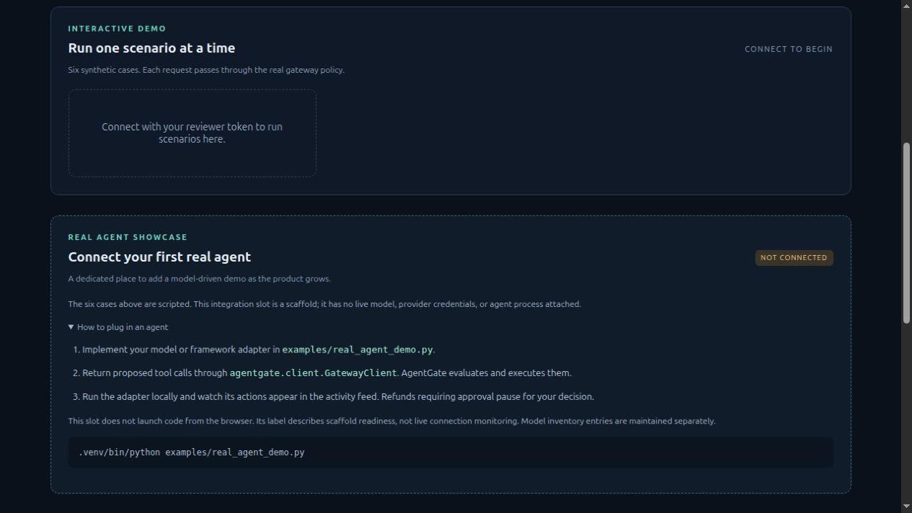

# Real agent showcase scaffold

> Historical synthetic workspace. For the default workspace on this branch, see
> [Local Sonar governance](local-sonar-governance.md).

The dashboard now reserves a **Real agent showcase** area. It is deliberately marked **Not connected**. The six scenario cards remain scripted; this separate slot is where a genuine agent integration can be added later.

## Implementation location

- `examples/real_agent_demo.py`: replace `ShowcaseAgent.next_action`, then set `ready=True`.
- `agentgate/client.py`: adapter interface, local gateway client, bounded agent run loop.

The adapter receives previous gateway action records and returns `ProposedAction(tool=..., arguments=...)` or `None` when finished. Use your chosen model SDK/framework in that method and translate its proposed tool calls. Provider credentials belong in environment variables outside Git, never in the dashboard inventory. No provider is selected or installed by this scaffold.

Conceptual adapter behavior:

```python
from agentgate.client import ProposedAction

# Inside next_action: obtain this choice from your real agent/framework.
return ProposedAction(
    tool="documents.read",
    arguments={"document_id": "refund-policy"},
)
```

That example is only the tool-call contract, not a model integration. Do not execute tools inside the adapter. Pass observed gateway results to the model as tool responses. The gateway remains responsible for policy and execution. Model outputs must not override server identity, permissions, or approval decisions.

## Run after implementing

Start AgentGate normally, connect the reviewer dashboard, then in another terminal:

```bash
.venv/bin/python examples/real_agent_demo.py
```

The unmodified scaffold prints **NOT CONNECTED** and makes no requests. Once implemented and marked ready, it reads the agent token from the environment or local `.env`, assigns a unique `showcase-...` run ID, and submits tool calls. Dashboard activity/profile totals pick up those calls through existing polling. The server still attributes this integration to `support-agent`; Sales and Finance integrations can use their separately configured agent credentials; see [the multi-agent guide](navigation-and-agents.md).

The client accepts loopback gateway URLs only and refuses HTTP redirects. The example limits runs to six tool proposals. A denied proposal is returned as a denied observation, never run locally. A pending approval stops the run; inspect and approve/reject it in the dashboard. No automatic resume exists yet. Transport failures stop the agent instead of bypassing the gateway. Add provider token/cost/time budgets before enabling a real model loop; the step limit bounds gateway submissions only.

## Current boundaries

A provider model can become real while tools remain synthetic. This scaffold does not add cloud discovery, endpoint/browser monitoring, provider connectivity verification, automatic profile registration, or a web-based agent process launcher. Model inventory must still be maintained separately. The dashboard's static placeholder is not a live readiness/health indicator; replace it with verified run/connector state as part of the eventual integration.


